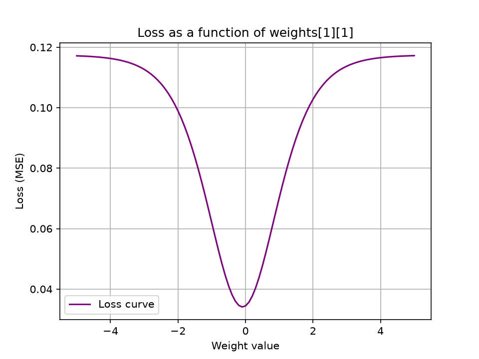
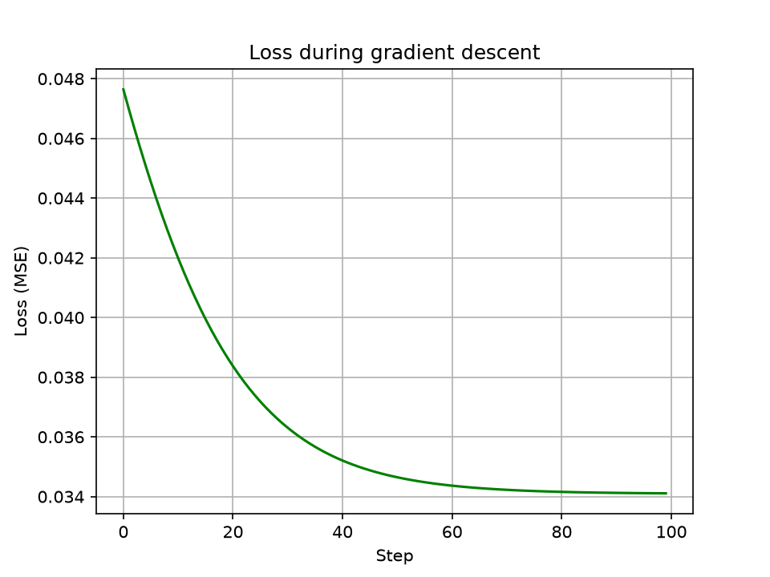

🇬🇧 English | [🇹🇷 Türkçe](README.tr.md)

# Week 1: Neural Network Basics

This week I built a tiny neural network in pure Python, with no ML libraries: a neuron, a layer, a loss function, and gradient descent using a numerical
derivative. The goal was to understand what happens inside a model before using any framework.

## What I built

All code is in [`week01.py`](week01.py).

1. **Single neuron forward pass**: weighted sum of the inputs plus a bias, passed through a sigmoid.
2. **Multi-neuron layer**: the same computation extended to 3 neurons, each with its own weights and bias.
3. **Loss function**: mean squared error (MSE) between the layer's outputs and the target values.
4. **Loss curve**: I varied one weight from -5 to 5 in steps of 0.1 and plotted how the loss changes.
5. **Gradient descent**: I estimated the slope numerically, `(loss(w + h) - loss(w)) / h`, and updated the weight step by step to reduce the loss.

## Results

**Loss curve (Task 4)**

The curve is bowl-shaped. The lowest loss on my grid is 0.0341 at `w = -0.1`, and the loss flattens out at about 0.117 for large positive or negative weights.
I set the second target to 0.5 instead of 0 or 1: a sigmoid never outputs exactly 0 or 1, so with those targets the curve would have no clear minimum.

**Gradient descent (Task 5)**

Starting from `w = 0.5` with a learning rate of 0.4, the loss dropped from 0.0476 to 0.0341 in 100 steps, and `w` moved to about -0.07. That is very close to the
minimum I found in Task 4, but not quite there: the steps get smaller as the slope flattens, so the weight approaches the minimum slowly instead of jumping past it.
